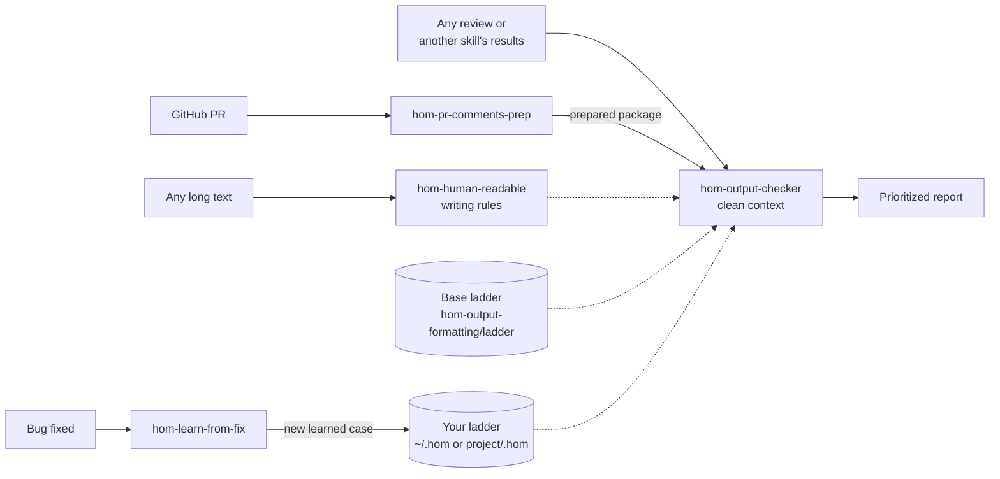

# homoantropos / skills

*Skills for Claude — and other agents — by a dabbler who believes AI should help us be more human.*

A set of agent skills in the open SKILL.md format for turning reviews, code checks and long documents into concise, prioritized reports. Findings are ranked by severity so that the most dangerous issues are addressed first.

## Contents

- [Skills](#skills)
- [Severity levels](#severity-levels)
- [How the skills fit together](#how-the-skills-fit-together)
- [Installation](#installation)
- [Learned cases](#learned-cases)
- [Safety](#safety)
- [Language](#language)
- [License](#license)

## Skills

All skills live in flat folders (`skills/<name>/`) so that any agent can discover them. They are grouped below by purpose.

### Output formatting

| Skill | Description |
|---|---|
| [`hom-human-readable`](skills/hom-human-readable/SKILL.md) | Converts any long text (a law, contract, specification, report or discussion thread) into an actionable brief: the bottom line, required actions and deadlines, key figures, details with a source reference for every claim, and a list of open questions. Defines the writing rules used by the other skills. |
| [`hom-output-formatting`](skills/hom-output-formatting/SKILL.md) | Takes the **text** of a review or code check, ranks its findings by [severity level](#severity-levels) and verifies them in a fresh context. Marks its own additions with 🔍, flags doubtful fixes and states explicitly when a fix is uncertain. Does not review code itself. Reference cases for each level are in [`ladder/`](skills/hom-output-formatting/ladder/), extended by [learned cases](#learned-cases). |

Each skill can be used on its own.

**Supporting agent:**

| Agent | Description |
|---|---|
| [`hom-output-checker`](agents/hom-output-checker.md) | Runs `hom-output-formatting` in a clean context without file tools, so the check stays independent of the reasoning that produced the review. Because it cannot read files, pass it the output of `skills/hom-output-formatting/scripts/load_ladder.sh` together with the review. Otherwise it warns that severity was assigned by general principles only. |

### Development

| Skill | Description |
|---|---|
| [`hom-pr-comments-prep`](skills/hom-pr-comments-prep/SKILL.md) | Collects the open review comments of a GitHub pull request, excludes resolved and bot threads, marks outdated ones, masks possible secrets, keeps the diff each comment refers to, and passes the result to `hom-output-checker`. |
| [`hom-learn-from-fix`](skills/hom-learn-from-fix/SKILL.md) | After a bug fix, identifies the root cause and actual impact. If the pattern is not yet covered, adds one generalized case to your local severity ladder, with no private details. |
| [`hom-skill-dryer`](skills/hom-skill-dryer/SKILL.md) | Optimizes a finished skill for token cost: tightens the description, keeps only what every run needs, moves rarely used material to `references/`, then runs the skill's evals and overwrites the skill only if they still pass. |

### General purpose

Planned. `hom-human-readable` already works with any text.

## Severity levels

Every finding is assigned one of five levels:

| | Level | Meaning |
|---|---|---|
| 🔴 | **Killed** (blocker) | Must not ship: incorrect results, crashes, freezes, security vulnerabilities, irreversible data loss, or code built on a false premise. |
| 🟠 | **Wounded** (must fix before commit) | Missing guards, race conditions, resource leaks, layout shift, violations of documented rules. |
| 🟡 | **Kicked in the pants** (should fix) | Possible failures; invasive or unrelated changes. |
| 🔵 | **Scolded** (minor) | Duplication, dead code, poor git hygiene. |
| 🟢 | **Praised** (positive) | Always included: what was done well, in the same order. |

Severity is determined by **how certain the harm is** and **whether an explicit agreement was broken**. Silent incorrect behavior ranks above crashes, because a crash is visible and an incorrect result may not be.

## How the skills fit together



## Installation

### Claude Code: plugin (recommended)

```
/plugin marketplace add homoantropos/skills
/plugin install homoantropos@homoantropos
```

The skills and the agent are installed together and are prefixed with the plugin name, for example `homoantropos:hom-output-checker`.

### Claude Code: install script

`hom-output-checker` is an **agent** located in `agents/`, so copying only `skills/` is not sufficient. The install script copies both:

```bash
git clone https://github.com/homoantropos/skills
cd skills
./install.sh                  # all projects: ~/.claude/skills and ~/.claude/agents
./install.sh ~/code/my-app    # one project:  ~/code/my-app/.claude/...
```

Run the script again to update. It replaces only the `hom-*` skills and the agent and never modifies learned cases. Start a new session after installing.

If the agent is unavailable, `hom-pr-comments-prep` falls back to a general-purpose subagent, then to the main session, and notes in the report that the check did not run in a clean context.

### Claude.ai

Upload each skill as a separate ZIP archive via **Customize → Skills → + → Upload a skill** (code execution must be enabled). Archive the entire skill folder so that `hom-output-formatting` includes its `ladder/` directory.

Supported on Claude.ai: `hom-human-readable`, `hom-output-formatting`, `hom-skill-dryer`. `hom-pr-comments-prep` and `hom-learn-from-fix` require `gh`, git and local file access, and are intended for Claude Code. On Claude.ai only the base ladder is used.

### Other agents

The skills use the open SKILL.md format: plain Markdown with a short YAML header. Copy the `skills/` folders to the location your agent reads skills from, or point it to [`AGENTS.md`](AGENTS.md).

## Learned cases

The base cases are in [`skills/hom-output-formatting/ladder/`](skills/hom-output-formatting/ladder/), one file per level. Each user or team extends the ladder locally: after a bug fix, `hom-learn-from-fix` may add one generalized case. Learned cases are never sent to this repository.

**Storage.** On the first learned case, the skill asks where to store it:

| Option | Location | Scope |
|---|---|---|
| Personal | `~/.hom/ladder/` | You, in every project on this machine |
| Team | `<your project>/.hom/ladder/` | Everyone on the project, once the folder is committed to your project's repository |

These folders contain only Markdown files with cases. To switch from personal to team storage, copy `~/.hom/ladder/*.md` to `<your project>/.hom/ladder/` and commit it.

**Merge order.** Before each check, `hom-output-formatting` merges cases in the order base → personal → team. If the same pattern appears at two levels, the higher level takes precedence. Updating the skills does not affect learned cases, because they are stored outside the installed skills.

**Format.** Each case is one line: `- <pattern> → <effect>. <reason for this level>`. Cases must not contain secrets, personal data, project, company or customer names, paths or identifiers. Each level file holds up to 30 cases. When a file is full, the skill proposes merging the two most similar cases and writes only with your consent.

## Safety

- No skill outputs, quotes or stores secrets or personal identifiers (passwords, API keys, tokens, card or ID numbers). They are replaced with `[REDACTED: <kind>]`, and a leaked secret is reported as a 🔴 finding with a recommendation to revoke and rotate it.
- `hom-pr-comments-prep` masks secret-like values with a script before PR text reaches the model.
- Skills operate only within your current project and never modify this repository.

## Language

Skills respond in the language of the request. For example, a request in Ukrainian receives an answer in Ukrainian, and a request in English about a Ukrainian document receives an answer in English.

## License

[MIT](LICENSE)
